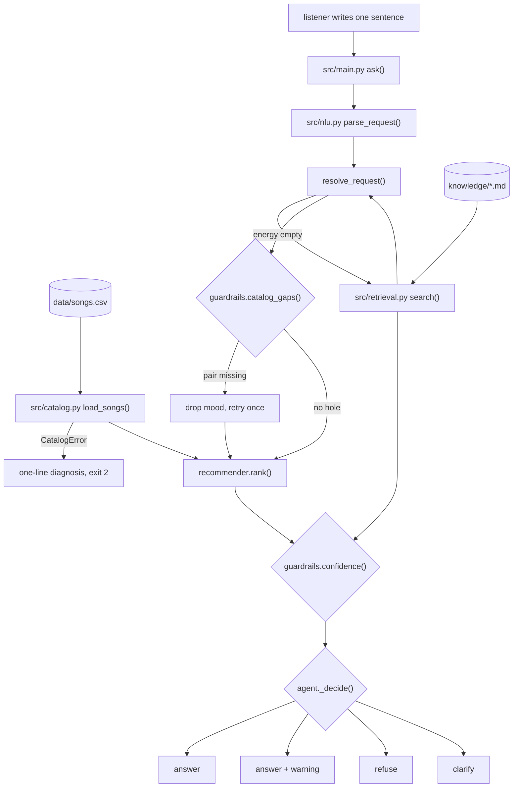

# 🎵 TasteRadar 2.0 — a recommender that knows when to stop

TasteRadar answers one sentence instead of three numbers, looks up what it does not
know in a small written knowledge base, and — the part the first version could not
do — refuses, or asks, when the catalog has nothing that fits.

---

## The base project

This is an extension of **TasteRadar 1.0**, my Modules 1–3 submission: a
content-based music recommender over a hand-built 20-song catalog. Given a taste
profile (favorite genre, favorite mood, target energy) it scored every song on
three rules, ranked them, and printed the top five with the points for each pick.

That behaviour is unchanged and still reproducible:

```bash
python -m src.main                 # the five original profiles, same numbers
git show v1.0-baseline:src/recommender.py   # the code as it was before 2.0
```

What 1.0 could not do, in its own words: *"The system has no way to return
nothing."* Ask it for euphoric 0.9-energy classical music and it returned
Gymnopédie No.1 — a calm piano piece at energy 0.12 — ranked first, looking exactly
like a normal answer.

---

## What 2.0 adds

| Capability | Where | What changed for the user |
| --- | --- | --- |
| **Free-text requests, English and Chinese** | `src/nlu.py` | "深夜写代码 别太吵" becomes genre/mood/energy, or a question |
| **A written knowledge base, searched** | `knowledge/`, `src/retrieval.py` | Missing details are filled from notes, and every fill is cited |
| **Retrieval-augmented explanations** | `src/agent.py` | Answers carry the exact section they relied on |
| **Four verdicts instead of one** | `src/guardrails.py` | answer / answer with warning / refuse / ask |
| **A labelled evaluation run** | `src/evaluate.py`, `reports/` | 11 requests checked on every change, with a written report |

The scoring recipe itself did not change: genre +2.0, mood +1.0, energy +1.0 ×
(1 − |gap|). That is deliberate. The extension is about *what the system does with
the score*, not about inventing a better score.

---

## Architecture

Source: [`diagrams/architecture.mmd`](diagrams/architecture.mmd) (Mermaid).



Data flow, in words:

1. **Input.** The sentence is parsed into slots. Only what is actually there gets
   filled; anything not understood is recorded, not ignored.
2. **Retrieval.** If the energy slot is empty and a situation was named, the
   knowledge base supplies a number — from the `Energy` section of that situation's
   note, with the citation kept.
3. **Processing.** The catalog is validated on load, scored by the single recipe,
   ranked with a deterministic tie-break. A catalog check may relax the mood
   constraint exactly once.
4. **Decision.** Confidence and issue list decide between answering, warning,
   refusing and asking. Human review is the fallback whenever the system is not
   confident.

---

## Setup

```bash
python -m venv .venv
source .venv/bin/activate        # Windows: .venv\Scripts\activate
pip install -r requirements.txt  # pytest only; everything else is the standard library
```

```bash
python -m src.main                            # the five original profiles
python -m src.main ask "chill lofi for late night coding"
python -m src.main ask "深夜写代码 别太吵" --trace
python -m src.main eval                       # writes reports/
python -m pytest -q                           # 75 tests
```

Exit codes from `ask`: `0` answered (with or without a warning), `1` needs more
information, `2` no confident match. A broken catalog also exits `2`, but before
any request is read.

---

## Sample interactions

### 1. A request the catalog can serve

```console
$ python -m src.main ask "chill lofi for late night coding"

Request   : chill lofi for late night coding
Genre     : lofi           <- text: "lofi"
Mood      : chill          <- text: "chill"
Context   : study          <- text: "late night"
Energy    : 0.35           <- text: "chill"
Excluded  : -
Unknown   : -
Evidence  : kb/context_study.md#What to avoid 0.28 | kb/context_study.md#Energy 0.21
Confidence: 0.96   [answer]

ask: genre=lofi, mood=chill, energy=0.35
1. Library Rain - Paper Lanterns  (4.00/4.00)
   because: genre match: lofi (+2.0) | mood match: chill (+1.0) | energy 0.35 vs target 0.35 (gap 0.00, +1.00)
2. Midnight Coding - LoRoom  (3.93/4.00)
   because: genre match: lofi (+2.0) | mood match: chill (+1.0) | energy 0.42 vs target 0.35 (gap 0.07, +0.93)
...
```

### 2. A request the catalog cannot serve, answered anyway — with a warning

There is no calm j-pop track in the catalog. The agent drops the mood constraint,
re-ranks, and says so.

```console
$ python -m src.main ask "calm j-pop"

Mood      : calm           <- text: "calm"
Confidence: 0.85   [caveat]
  relax : dropped the mood constraint, no track in the catalog matched it

1. 晩餐歌 - tuki.  (2.88/4.00)
   because: genre match: j-pop (+2.0) | no mood given (+0.0) | energy 0.62 vs target 0.50 (gap 0.12, +0.88)
...
```

### 3. A request it refuses

```console
$ python -m src.main ask "classical high energy"     # exit code 2

Confidence: 0.52   [refuse]
  warn : no classical track is near 0.90 energy (closest is 0.12: Gymnopédie No.1)

No confident match.
  closest : Gymnopédie No.1 - Erik Satie (classical/calm, energy 0.12, 2.22/4.00)
```

### 4. A request with no clue in it

```console
$ python -m src.main ask "深夜写代码 别太吵"          # exit code 1

Context   : study          <- text: "深夜"
Energy    : 0.33           <- kb/context_study.md#Energy (0.25-0.42)
Unknown   : 别太, 太吵

Question  : I need one more clue. Name a genre (lofi, j-pop, pop, ambient, ...)
            or a mood (chill, energetic, happy, ...), or a situation like studying.
```

The options in that question are read from the catalog at runtime, ordered by how
many songs carry them — not hardcoded.

---

## Design decisions

**One scoring implementation, derived output.** `score_song()` returns a
`ScoreBreakdown` of per-rule items; the ranking and the explanation text are both
rendered from that same object. An earlier version computed the explanation in a
second pass over a parallel code path, which meant a new rule had to be added
twice and the forgotten copy would drift silently.

**Retrieval fills holes, never overrides.** A knowledge-base number is only applied
to a slot the listener left empty, and the source is printed. Ask for energy 0.8 in
a study context and the note's 0.33 is ignored.

**Confidence is multiplicative, not additive.** `fit × (0.80 + 0.20 × support)`.
A result that misses an explicit constraint cannot be rescued by a big gap to the
runner-up or a strong citation — which is exactly what an additive score would
allow.

**Catalog holes are facts, not thresholds.** "No j-pop track is tagged calm" is
read off the data. Nothing is tuned to discover it, and the check cannot be
satisfied by a better score.

**Offline and deterministic.** No model, no API key, no network. The retrieval is
TF-IDF with CJK character bigrams, the parser is a word table. This costs semantic
matching (see Limitations) and buys reproducibility: anyone can clone, install
`pytest`, and get the same 11/11 evaluation.

**Only the mood is ever relaxed.** Genre is worth 2.0 on its own and is the hardest
boundary in the recipe; dropping it would not make the answer more honest, it would
answer a different question.

---

## Guardrails: input, behaviour, result

| Input | Behaviour | Result |
| --- | --- | --- |
| `""` | no clue at all | asks one question, exit 1 |
| `"chill lofi 别太吵"` | `别太` / `太吵` not understood | answers, warns, confidence ×0.90 |
| `"classical high energy"` | no classical track near 0.9 | refuses, names the closest track and its real energy |
| `"calm j-pop"` | pair exists nowhere in the catalog | drops mood, answers with a warning naming the drop |
| `data/songs.csv` with a blank `energy` | row-level validation on load | `line 7 (id=6): column 'energy' is empty`, exit 2 |
| `energy = nan` | non-finite rejection at load | refused before scoring, because NaN poisons every comparison |
| duplicate `id` | validation on load | `duplicate id 2, already used on line 3` |

---

## Evaluation

`python -m src.main eval` runs 11 labelled requests and writes
[`reports/evaluation.md`](reports/evaluation.md) and `.json`. Each case asserts a
*property* of the verdict — decision, top genre, whether mood was relaxed,
confidence bounds — never the wording, so the table survives copy changes.

Current result: **11/11**, with 6 answers, 1 caveat, 2 refusals, 2 questions.

The most useful line in the report is the threshold check: answered cases sit at
0.85–0.96, refused cases at 0.51–0.52. The `0.55` refusal boundary is not load
bearing for this set — it could move anywhere inside that gap without changing a
verdict. That is an honest statement about how thin the calibration evidence is.

The first run of this harness failed 5 of 11 cases and found a real parser bug:
filler words such as `我想` and `something` were counted as "not understood", which
downgraded correct answers to warnings. The parser's own unit tests had not caught
it, because none of them asked whether a *complete* sentence survived the round
trip.

---

## The recipe, in detail

| Rule | Points |
| --- | --- |
| Genre matches `favorite_genre` | +2.0 |
| Mood matches `favorite_mood` | +1.0 |
| Energy similarity | +1.0 × (1 − \|song.energy − target_energy\|) |

Genre carries the heaviest weight because it is the hardest boundary. Energy is
scored by distance rather than height: a 0.93 track scores badly for a target of
0.2. Maximum is 4.0.

Ranking sorts by score descending, then closer energy, then lower id, so the same
input always produces the same list.

Two weight experiments, re-run against the unified implementation:

```
baseline 2/1/1        : Sunrise City 3.97 | Gym Hero 2.92 | Rooftop Lights 1.91 | 火炎 1.00 | Storm Runner 0.94
genre 1.0, energy 2.0 : Sunrise City 3.94 | Gym Hero 2.84 | Rooftop Lights 2.82 | 火炎 2.00 | Storm Runner 1.88
mood removed          : Sunrise City 2.97 | Gym Hero 2.92 | 火炎 1.00 | Storm Runner 0.94 | Rooftop Lights 0.91
```

Halving genre barely reorders the list; it only squeezes the gaps. Removing mood
drops Rooftop Lights from third to fifth while Gym Hero does not move at all — the
mood term is doing real work only for songs whose genre is already wrong. Both are
a single `Weights(...)` argument, not a code change.

---

## Limitations

- **The catalog is 20 hand-tagged songs.** Thirteen of sixteen genres appear once.
  More than one refusal in the evaluation is a statement about the data, not the
  logic.
- **Retrieval is lexical.** `workout` and `training` are unrelated unless both are
  written in the note's tags. There is no stemming and no synonyms beyond the
  hand-written table.
- **The parser is a word table.** Anything outside it lands in `Unknown` and lowers
  confidence rather than being guessed at.
- **Negation is a 16-character lookback.** "这首歌不错" reads as a negation because
  of the `不`. Known, unfixed, and cheap to hit.
- **Refusal thresholds are provisional.** 0.55 and 0.70 were chosen before the
  evaluation set existed and are only as good as those 11 cases.
- **A genre match is still nearly veto-proof** inside the score itself, which is the
  old bias; the guardrails now name it, they do not remove it.

The reasoning, the collaboration notes and the ethics section live in the
[Model Card](model_card.md).

---

## Repository layout

```
data/songs.csv            the 20-song catalog, validated on load
knowledge/*.md            8 hand-written notes, the retrieval corpus
diagrams/architecture.mmd Mermaid source for the diagram above
src/catalog.py            loading + row-level validation
src/recommender.py        the single scoring recipe
src/retrieval.py          TF-IDF + CJK bigrams
src/nlu.py                text -> slots
src/guardrails.py         catalog gaps + confidence
src/agent.py              the loop, the four verdicts, the trace
src/evaluate.py           labelled evaluation + report
src/main.py               CLI: profiles, ask, eval
tests/                    75 tests
reports/                  generated evaluation output
```
